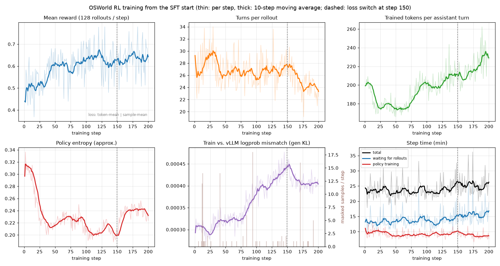

# OSWorld RL with FlashREINFORCE (NeMo RL v2 + NeMo Gym)

This directory is the complete, runnable FlashREINFORCE recipe for OSWorld computer-use RL on Nemotron Omni, together
with the HF export and evaluation procedure behind the reported numbers. The NeMo RL code is this branch; the NeMo Gym
code is the pinned submodule `3rdparty/Gym-workspace/Gym`.

The RL recipe (FlashREINFORCE), the training data (union2698) and the OSWorld harness come from Yi Dong's team.
Linglin Jing implemented them on NeMo RL v2 and NeMo Gym.

## Results

OSWorld eval-361 (no Google Drive tasks), 4 seeds × 361 tasks, `osworld-v1` sandbox template, 49,152-token context,
200 agent steps, T=0.6, top_p=0.95:

| Model | Pass@1 | Pass@4 | Mean agent steps |
|---|---|---|---|
| SFT (RFC0040 iter881, the starting point) | 51.74 | 65.10 | 37.0 |
| RL step 200 (this recipe) | **57.90** | **69.53** | 29.3 |

Paired step200 − iter881: Pass@1 +6.16 [+3.58, +8.80], Pass@4 +4.43 [+1.39, +7.76] (task-level bootstrap, 95% CI).
Per-seed Pass@1 of step 200 is 59.18 / 57.37 / 59.77 / 55.30, so expect about ±2 points of seed noise.
Training took 200 optimizer steps at 24 minutes per step on average (80 hours on 4 nodes).

## What the recipe does

| Setting | Value |
|---|---|
| Algorithm | FlashREINFORCE: REINFORCE with a prompt-group mean baseline (`adv_estimator: dr_grpo`, no std normalization), on-policy ratio forced to 1, no reference-policy KL |
| Train/inference mismatch correction | Sequence-level binary-KL gate (`seq-mask-tis`, threshold 0.01): a rollout whose sampled-token KL between vLLM and the Megatron policy exceeds 0.01 is masked out |
| Batch | 32 prompts × 4 rollouts = 128 trajectories per optimizer step; the 4 rollouts of a prompt are forks of one initialized sandbox |
| Optimizer | Adam, constant lr 5e-6, grad clip 1.0, seed 43 |
| Loss aggregation | token-mean for steps 1–149, seq-mean-token-mean for steps 150–200 (see [Training](#4-train)) |
| Context | 49,152 tokens with 8,192 reserved for generation; RFC0040 K8/S3 policy (old screenshots replaced by an omission marker, at most 11 images); every segment of a context-compacted rollout gets the trajectory reward |
| Agent | up to 200 turns, 3,600 s rollout timeout, canonical OSWorld harness prompts and execution feedback |
| Sandboxes | AgentEnv cell-3, templates `osworld-v1:1,osworld-slim:1,osworld-v2:1` sampled per task |
| Rollout | async, 80 parallel rollouts, 32 prompts in flight, 32 buffered rollouts |
| Topology | 4 nodes × 8 GPUs: 1 Megatron policy node + 3 vLLM generation nodes |
| Checkpoints | every 2 steps and at the last step of every job segment |

Files:

| File | Purpose |
|---|---|
| `examples/nemo_gym/grpo_nemotron_omni_30ba3b_osworld_yi_union2698_agentenv_flash_b32n4.yaml` | The recipe (`OSWORLD_RECIPE=yi-union2698-agentenv-flash-b32n4`) |
| `env/phase1_token_mean.env.example` | Launcher settings for steps 1–149 |
| `env/phase2_seq_mean_token_mean.env.example` | Launcher settings for steps 150–200 |
| `config_step200_resolved.yaml` | Fully resolved config of the reported run at step 200, for comparison |
| `hf_export/` | Megatron checkpoint → Hugging Face export |
| `eval/` | Eval harness patch and Pass@k aggregation with paired bootstrap |
| `patches/` | One Megatron-LM patch (see below) |
| `../submit.sh`, `../driver.sh`, `../node_setup.sh`, `../runtime_env.sh` | Shared Slurm launcher used by this recipe |

## 1. What you need

| Input | Where to get it |
|---|---|
| Slurm cluster with Pyxis/Enroot | 4 nodes × 8 GPUs (the reported run used H100 80 GB). A shared filesystem visible at the same path from the submit host and all compute nodes |
| Container | `rl-osworld-v2-qualified-69764640.sqsh`, sha256 `1b4edcde…eb74e` (`submit.sh` verifies it). On NRT: `/lustre/fs1/portfolios/nemotron/projects/nemotron_omni_vision/users/linglinj/artifacts/containers/`. Elsewhere: copy it, or rebuild it from the release assets with `../download_container.sh` (needs access to the private release) |
| Base policy | RFC0040 iter881 HF export, including `chat_template.jinja`: `/lustre/fs1/portfolios/nemotron/projects/nemotron_omni_vision/users/yifazhang/rfc0040_k8_s3_hf_native_runtime_recovery_v1_production_20260820/exports/iter_0000881/mcore_to_hf` |
| Training data | union2698 snapshot (2,698 tasks): `.../users/linglinj/artifacts/data/osworld/union2698-astra-assets-20261028/yi-rpga-union2698-exact-20261022/` with `train.jsonl`, `assets/` and `tmp_funcs/` (custom evaluators). Readable by group `llmservice` |
| OSWorld harness | The canonical harness (`mm_agents/nvidia/nemotron_agent.py`, `desktop_env/execution_feedback.py`) is internal code and is not in this public repo. Take the `harness/` directory from the internal reproduction bundle (GitLab project `linglinj/osworld-step200-repro`; ask the owner for access) and clone it onto the shared filesystem. `submit.sh` checks both files against the sha256 values in the env template |
| Evaluator tools rootfs | `.../users/linglinj/artifacts/cache/osworld-evaluator-tools/rootfs` |
| AgentEnv access | Endpoint, API key and the cell-3 CA certificate, from the AgentEnv team. Every compute node must reach the endpoint on TCP 443 (on a new cluster this usually needs a network ACL) |
| W&B (optional) | API key and entity; or set `OSWORLD_WANDB_ENABLED=false` |

`...` above stands for `/lustre/fs1/portfolios/nemotron/projects/nemotron_omni_vision`. On oci-nrt-slurm-1 the same
filesystem is mounted at `/scratch/fsw` instead of `/lustre/fs1`; see [Cluster notes](#cluster-notes).

## 2. Get the code

```bash
git clone --branch linglinj/osworld-flashreinforce https://github.com/jinglinglingling/RL.git nemo-rl-osworld-flash
cd nemo-rl-osworld-flash
git submodule update --init 3rdparty/Gym-workspace/Gym 3rdparty/Megatron-Bridge-workspace/Megatron-Bridge
(cd 3rdparty/Megatron-Bridge-workspace/Megatron-Bridge && git submodule update --init 3rdparty/Megatron-LM)
(cd 3rdparty/Megatron-Bridge-workspace/Megatron-Bridge/3rdparty/Megatron-LM && \
  git apply ../../../../../examples/nemo_gym/osworld_v2/flashreinforce/patches/megatron-lm-1e7598cb-dcp-picklable-exception.patch)
```

Clone onto the shared filesystem: every node mounts this checkout at `/opt/nemo-rl`.

| Component | Commit |
|---|---|
| NeMo Gym | `b9cff9f1` on `jinglinglingling/Gym` branch `linglinj/osworld-flashreinforce` (the training code plus kill-on-timeout for AgentEnv sandboxes) |
| Megatron-Bridge | `5ed9799` (upstream) |
| Megatron-LM | `1e7598cb` (upstream) + `patches/megatron-lm-1e7598cb-dcp-picklable-exception.patch`, which only keeps DCP checkpoint errors picklable on Python 3.13 and has no numerical effect |

## 3. Write the env file

All launcher settings live in one env file. It contains keys, so keep it outside git and private:

```bash
mkdir -p ~/osworld-private && chmod 700 ~/osworld-private
cp examples/nemo_gym/osworld_v2/flashreinforce/env/phase1_token_mean.env.example ~/osworld-private/phase1.env
chmod 600 ~/osworld-private/phase1.env
```

Fill in every `<...>` placeholder:

| Variable | Meaning |
|---|---|
| `OSWORLD_CANONICAL_HARNESS_ROOT` | Your copy of the bundle's `harness/` directory |
| `AGENTENV_ENDPOINT`, `AGENTENV_API_KEY`, `AGENTENV_TLS_CA` | AgentEnv cell-3 endpoint URL, API key, path to the CA certificate |
| `SLURM_ACCOUNT`, `SLURM_PARTITION` | Your Slurm account and a partition with 4-hour jobs |
| `OSWORLD_RESULTS_ROOT` | Output root; the run is written to `$OSWORLD_RESULTS_ROOT/$SERIES` |
| `<your-cache>` | A directory you own for the HF cache, the Gym virtualenv and runtime libraries |
| `WANDB_ENTITY`, `WANDB_API_KEY` | Or set `OSWORLD_WANDB_ENABLED=false` |

Copy the four host libraries the container needs (`submit.sh` otherwise looks for them on the submit host, and most
login nodes do not have `libopenblas`):

```bash
mkdir -p <your-cache>/nemo-rl-v2-osworld/runtime-libs
cp /lustre/fs1/portfolios/nemotron/projects/nemotron_omni_vision/users/linglinj/artifacts/cache/nemo-rl-v2-osworld/runtime-libs/* \
  <your-cache>/nemo-rl-v2-osworld/runtime-libs/
```

Also set `SERIES` to a run name and never change it afterwards: resubmits and phase 2 find the checkpoints through it.
The other values (container, base model, data, recipe, topology) are the ones of the reported run; leave them unless
you deliberately want a different setup.

## 4. Train

Check the env file without submitting. This validates every required variable and file, the container checksum and
the harness sha256s, and prints where the run will be written:

```bash
OSWORLD_SUBMIT_DRY_RUN=1 bash examples/nemo_gym/osworld_v2/submit.sh ~/osworld-private/phase1.env
# dry_run=ok
# series_root=...
```

**Phase 1, steps 1–149 (token-mean):**

```bash
bash examples/nemo_gym/osworld_v2/submit.sh ~/osworld-private/phase1.env
```

This submits a dependency chain of `OSWORLD_CHAIN_LENGTH=40` jobs of 4 hours each. Every job resumes from the latest
checkpoint, trains about 8 steps and saves before 3h40m. Training stops at `step_149`. Jobs of the chain that start
after that still go through node setup and model loading before they exit without training, so `scancel` the rest of
the chain once `step_149` is saved. Phase 1 is about 60 hours of training time plus the startup of each job.

**Phase 2, steps 150–200 (seq-mean-token-mean):** after `checkpoints/step_149` exists,

```bash
cp examples/nemo_gym/osworld_v2/flashreinforce/env/phase2_seq_mean_token_mean.env.example ~/osworld-private/phase2.env
chmod 600 ~/osworld-private/phase2.env
# edit the `source` line so it points at ~/osworld-private/phase1.env
bash examples/nemo_gym/osworld_v2/submit.sh ~/osworld-private/phase2.env
```

Phase 2 resumes from `step_149` in the same series, switches the loss aggregation, and first keeps a hard-linked copy of
`step_149` in `checkpoints/preserved_last_token_mean`, because checkpoint rotation would otherwise delete it.

The reported run used this two-phase schedule. Running all 200 steps with a single loss aggregation was not tested.

### Monitor

`submit.sh` prints the series root and the job IDs. Useful files:

```bash
S=$OSWORLD_RESULTS_ROOT/$SERIES
cat $S/submissions.tsv                                   # segment -> job ID
squeue -u $USER -o '%.18i %.10T %.30j %.10M %.20R'
less $S/segments/segment-001/slurm-<jobid>.out           # node setup and preflight checks
less $S/segments/segment-001/<jobid>-logs/ray-driver.log # training log
cat $S/checkpoints/latest_checkpoint_status.json         # last saved step
```

Every job first sets up the nodes, the Gym environment and the model before its first step; the first job also builds
the Gym virtualenv. Compare your W&B or TensorBoard curves with the [training curves](#training-curves) below.

### Resume, extend or stop

- **Resume after a failure or when the chain ran out:** submit the same env file again. It continues from the latest
  checkpoint of `SERIES` and appends new segments.
- **Change the number of steps:** `OSWORLD_GRPO_MAX_STEPS` is the step at which training stops.
- **Stop:** `scancel` the running job and its pending successors. Nothing after the last saved checkpoint is lost
  except the steps since that save (at most 2).

### Settings you may want to change

These are read by `submit.sh`/`driver.sh` and override the recipe:

| Variable | Default in the template | Effect |
|---|---|---|
| `OSWORLD_GRPO_MAX_STEPS` | 149 (phase 1), 200 (phase 2) | Last optimizer step |
| `OSWORLD_LOSS_AGG_MODE` | unset (token-mean) | `seq-mean-token-mean` also sets `token_level_loss=false` |
| `OSWORLD_SEED` | 43 | Sampling seed |
| `OSWORLD_MAX_PARALLEL_ROLLOUTS` | 80 | Concurrent sandboxes; bounded by your AgentEnv quota |
| `OSWORLD_MAX_INFLIGHT_PROMPTS`, `OSWORLD_MAX_BUFFERED_ROLLOUTS` | 32, 32 | Async rollout depth |
| `AGENTENV_TEMPLATE_WEIGHTS` | `osworld-v1:1,osworld-slim:1,osworld-v2:1` | Sandbox templates and their sampling weights |
| `OSWORLD_NUM_NODES`, `OSWORLD_CLUSTER_NUM_NODES`, `OSWORLD_GENERATION_NUM_NODES` | 4, 4, 3 | Total nodes and vLLM nodes; the policy uses the rest |
| `OSWORLD_JOB_TIME`, `OSWORLD_CHECKPOINT_MUST_SAVE_BY` | `04:00:00`, `00:03:40:00` | Change both together if your partition has a different time limit |
| `OSWORLD_CHAIN_LENGTH` | 40 (phase 1), 15 (phase 2) | Jobs submitted per `submit.sh` call |
| `OSWORLD_GRPO_TRAIN_DATA`, `OSWORLD_RLVR_SNAPSHOT` and the `OSWORLD_RLVR_*` roots | union2698 | Another task snapshot with the same layout (`train.jsonl`, `assets/`, `tmp_funcs/`) |

Anything else (lr, batch size, KL gate threshold, context length) is in the recipe YAML.

### Cluster notes

- **oci-nrt-slurm-1:** replace `/lustre/fs1/` with `/scratch/fsw/` in every path of the env file, and use
  `SLURM_PARTITION=batch` with `export SBATCH_QOS=normal`. `submit.sh` adds the `/scratch/fsw:/lustre/fs1` mount
  automatically, because the data files contain `/lustre/fs1` paths. AgentEnv cell-3 must be reachable from the
  compute nodes; check with `curl --cacert $AGENTENV_TLS_CA -sS -o /dev/null -w '%{http_code}\n' $AGENTENV_ENDPOINT`
  (any HTTP status means reachable; `000` after a timeout means the network path is blocked).
- **AgentEnv sandboxes are killed at their TTL** (`auto_resume: false` in the Gym AgentEnv provider). AgentEnv pauses
  sandboxes by default and never evicts paused ones, which slowly exhausts the quota of a long run.
- **About 12–13% of rollouts hit the 49K context guard** (median turn 55) at every stage of training. This is expected:
  all text history, including past reasoning, is kept.

## Training curves



From the TensorBoard logs of all 200 steps. Thin lines are per step, thick lines a 10-step moving average, and the
dashed line marks the loss switch at step 150. A healthy run should look similar:

- Mean training reward rises from 0.50 (steps 1–10) to 0.63 (steps 141–150) and 0.64 (steps 191–200).
- Entropy drops from 0.31 to about 0.20 in the first 30 steps, then stays between 0.20 and 0.24. It does not collapse.
- Rollouts take 26–28 turns for most of training and about 23 at the end.
- Tokens per assistant turn stay between 175 and 230.
- Train vs. vLLM mismatch (gen KL) stays below 5e-4. The binary-KL gate masked 118 samples in total, about 0.5%.
- A step takes 24 minutes on average (14 minutes waiting for rollouts, 9 minutes policy training), and stays flat.

## 5. Export to Hugging Face

```bash
REPO=<RL checkout> CONTAINER=<sqsh> CKPT=<series>/checkpoints/step_200 OUT=<new hf dir> \
  sbatch -A <account> -p <partition> examples/nemo_gym/osworld_v2/flashreinforce/hf_export/export_hf.sbatch
```

One node. On slurm-1 also set `LUSTRE_MOUNT=/scratch/fsw:/lustre/fs1`. The wrapper only makes the
copied read-only `modeling*.py` files writable before the Bridge post-processing, which otherwise raises
`PermissionError` on rank 0 and hangs ranks 1–7. Afterwards, replace all non-weight files in `OUT` with the copies from
the iter881 HF export, as described in the sbatch header. Sanity check: 17 shards, 7,349 tensors with key/shape/dtype
identical to iter881. LLM weights differ by about 0.1–0.3% relative; the vision and sound towers are unchanged.

Already exported checkpoints: step 200 at `.../users/linglinj/artifacts/models/v6_step200_hf` (NRT) and
`.../users/linglinj/osworld-hsg-eval/models/v6_step200_hf` (HSG); iter881 at
`.../users/linglinj/artifacts/models/rfc0040_iter881` (HSG).

## 6. Evaluate

The reported numbers come from the RPGA OSWorld eval harness on the HSG cluster. That harness is internal and is not
part of this repo; it is in the internal reproduction bundle (`rpga/`, commit `eda332d9`). Contract: `rfc0015_v1` agent,
`hf_tools`, `feedback_v2`, K8/S3, 200 steps, T=0.6, top_p=0.95, 16,384 tokens per turn, 49,152 context, `osworld-v1`
template (forced by `EVAL_ONLY=1`), 7,200 s per episode. One node with 4 TP1 vLLM engines and 32 concurrent episodes,
about 1 h 10 min per seed.

From `rpga/scripts/osworld` of the bundle, with `R` a directory you own and your own copies of the cell-3 credential
file (`endpoint=` / `apikey=` lines, mode 600) and CA:

```bash
export R=<your output dir> CELL2_CRED_FILE=<your credential file> AENV_TLS_CA=<your cell-3 CA>
F=/lustre/fs1/portfolios/nemotron/projects/nemotron_omni_vision/users/linglinj/osworld-hsg-eval/data/validation_nogdrive_361_gym.jsonl
for s in 1 2 3 4; do
  RUN_ID=<name>_s$s SEED=$s MODEL_PATH=<hf export> VAL_DATA=$F TRAIN_DATA=$F \
  EVAL_BATCH_SIZE=361 ROLLOUT_GENERATE_BATCH_SIZE=361 OSWORLD_ROLLOUT_TIMEOUT_SEC=7200 \
    sbatch -q interactive -t 04:00:00 osworld_eval_hsg.sbatch
done
```

Required harness fix: several eval-361 tasks pass `expected_returncodes` / `on_nonzero` to setup steps, which the
pinned OSWorld `SetupController` rejects. `eval/rpga_setup_returncode_contract.py` is the patch applied inside the
agent (same semantics as NeMo Gym `osworld_agent/client.py`). Without it those tasks fail as infrastructure errors.

Aggregate the four seeds:

```bash
python3 examples/nemo_gym/osworld_v2/flashreinforce/eval/aggregate_paired.py --tasks $F \
  --model step200=<run_s1>,<run_s2>,<run_s3>,<run_s4> --model iter881=<run_s1>,...
```

It prints Pass@1, Pass@4, paired bootstrap CIs and per-domain scores. Four tasks fail with a `killall` setup error for
every model and seed; excluding them gives 58.55 / 70.31 for step 200 and 52.32 / 65.83 for iter881.

## Notes on the reported run

The inputs listed above are the final ones and are what we recommend. The original run differed slightly early on:

- Steps 1–~6 ran with `OSWORLD_GRPO_MAX_STEPS=100`, raised to 200 afterwards. lr is constant, so the schedule is the
  same.
- Steps 1–~32 read tasks from `.../users/linglinj/artifacts/data/osworld/yi-rpga-union2698-exact-20261022` with Yi's
  asset root and setup cache. Steps ~33–87 used `train.agentenv-safe-v1.jsonl` from that snapshot, which differs only
  in a best-effort clipboard setup for task `os_r4_1158_v2`. Steps 88–200 used the local-asset copy listed above: the
  same 2,698 rows in the same order, and the same harness.
- The iter881 eval seeds 1–2 ran with a 3,600 s budget, and their timed-out or returncode-affected tasks were re-run at
  7,200 s. Seeds 3–4 and all step-200 seeds ran at 7,200 s.
